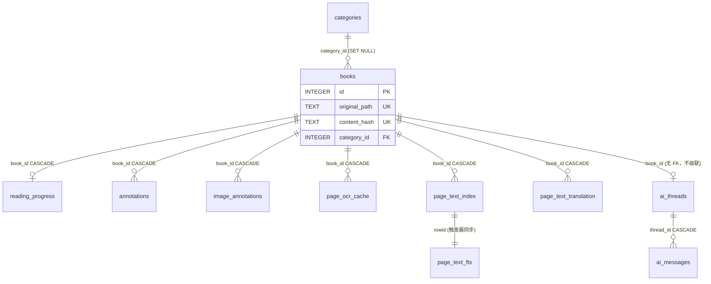

# 数据模型（DATA_MODEL）

> 目标读者：需要**直接改数据库结构**的人。所有结论都带 `路径:行号`，行号来自当前工作树实际读取。
> 源码位置约定：`schema.rs` = `rust/src/db/schema.rs`；`connection.rs` = `rust/src/db/connection.rs`；`repo/*` = `rust/src/db/repository/*.rs`。

---

## 1. 概览

| 项 | 值 | 证据 |
|---|---|---|
| 引擎 | SQLite | `connection.rs:115` |
| 日志模式 | WAL | `schema.rs:338`（`PRAGMA journal_mode = WAL;`） |
| 外键 | 每个连接开启 | `schema.rs:339` + `connection.rs:118-120` |
| 同步级别 | `synchronous = NORMAL` | `schema.rs:340` |
| 全文检索 | FTS5 external-content 虚表 `page_text_fts` | `schema.rs:218-223` |
| 当前版本 | `SCHEMA_VERSION: u32 = 11` | `schema.rs:40` |
| 版本表 | `schema_version`（取 `MAX(version)`） | `schema.rs:330-333`、`connection.rs:190-195` |
| DDL 执行点 | 每次启动 `execute_batch(SCHEMA_SQL)`，随后 `migrate()` | `connection.rs:122-126` |
| 时间戳 | ISO-8601 TEXT（`datetime('now')` 默认值） | `schema.rs:10` |
| 坐标 | REAL，归一化到 `[0.0, 1.0]` | `schema.rs:9` |

**本项目不保证迁移向后兼容**：需要时可直接 bump `SCHEMA_VERSION` 并重写 DDL——唯一例外是 `settings` 表里 `key='ai_config'` 的 AI 设置 JSON（见 §6），它是后续测试的基准数据，任何结构改动都不得丢失它。

两条结构性约定（改库时必须知道）：

1. `SCHEMA_SQL` **永远是最新全量 DDL**，且带 `IF NOT EXISTS`，每次启动都会执行（`schema.rs:82-85`、`connection.rs:123`）。因此**纯新增表**在老库上会被自动建出来，迁移分支只需 `record_version`（`connection.rs:257-264`、`285-291`）。
2. 涉及**新列的索引**不能放进 `SCHEMA_SQL`：老库上 `execute_batch(SCHEMA_SQL)` 早于 ALTER 执行，引用缺失列会直接失败。于是有 `ensure_ai_window_indexes` / `ensure_book_hash_index` 这类「迁移后再建」的函数（`schema.rs:42-80`、`connection.rs:307-318`）。

---

## 2. 表清单

共 **13 张实体表**（含 1 张版本簿记表 `schema_version`）+ **1 张 FTS5 虚表**。

| # | 表名 | 用途 | 主键 | 外键 / 级联 | repository 模块 | schema.rs |
|---|---|---|---|---|---|---|
| 1 | `categories` | 自定义分类 | `id` | 被 `books.category_id` 引用 | `repo/category.rs` | 90-95 |
| 2 | `books` | 书库条目 | `id` | `category_id` → `categories(id)` ON DELETE SET NULL | `repo/book.rs` | 102-120 |
| 3 | `reading_progress` | 阅读位置（页 / 缩放 / 版式） | `book_id` | `book_id` → `books(id)` CASCADE | `repo/progress.rs` | 126-133 |
| 4 | `annotations` | 文本层标注（高亮/下划线/删除线/批注） | `id` | `book_id` → `books(id)` CASCADE | `repo/annotation.rs` | 140-154 |
| 5 | `image_annotations` | 图片层标注（笔刷/形状/便签/印章） | `id` | `book_id` → `books(id)` CASCADE | `repo/image_annotation.rs` | 161-179 |
| 6 | `page_ocr_cache` | 整页 OCR 结果缓存 | `(book_id,page,ocr_mode)` | `book_id` → `books(id)` CASCADE | `repo/ocr.rs` | 185-193 |
| 7 | `page_text_index` | 每页文本（PDF 文本层或 OCR 结果） | `(book_id,page)` | `book_id` → `books(id)` CASCADE | `repo/search.rs` | 204-213 |
| 8 | `page_text_fts` | 全文索引（FTS5 虚表） | rowid（= `page_text_index.rowid`） | 无 FK，靠触发器同步 | `repo/search.rs`（查询/写入都经 `page_text_index`） | 218-223 |
| 9 | `ai_threads` | AI 会话窗口（每本书一个） | `id` | **无 FK**（删书保留会话） | `repo/ai.rs` | 245-253 |
| 10 | `ai_messages` | 会话内消息 | `id` | `thread_id` → `ai_threads(id)` CASCADE | `repo/ai.rs` | 255-265 |
| 11 | `translation_glossary` | 术语表（固定译名） | `id` | 无 | `repo/translate.rs` | 276-283 |
| 12 | `page_text_translation` | 文本级翻译缓存（安卓双语） | `id` | `book_id` → `books(id)` CASCADE | `repo/text_translation.rs` | 293-315 |
| 13 | `settings` | KV 配置（AI 设置、主题、面板宽度…） | `key` | 无 | `repo/settings.rs` | 321-325 |
| — | `schema_version` | 迁移闸门 | `version` | 无 | 仅 `connection.rs` 直接写 | 330-333 |

### 2.1 `categories` — 分类（`schema.rs:90-95`）

| 列 | 类型 | 约束 | 说明 |
|---|---|---|---|
| `id` | INTEGER | PK AUTOINCREMENT | 分类 id |
| `name` | TEXT | NOT NULL **UNIQUE** | 分类名，唯一约束在 `schema.rs:92` |
| `sort_order` | INTEGER | NOT NULL DEFAULT 0 | 列表排序 |
| `created_at` | TEXT | NOT NULL DEFAULT `datetime('now')` | 创建时间 |

- 外键：无出边；被 `books.category_id` 指向，删分类时把书置为未分类（`schema.rs:115-116`）。
- 读写：`category::list`（`repo/category.rs:24`）、`create`（:36）、`rename`（:59）、`delete`（:70）。
- 索引：仅 `name` 的唯一索引（隐式）。

### 2.2 `books` — 书库条目（`schema.rs:102-120`）

| 列 | 类型 | 约束 | 说明 |
|---|---|---|---|
| `id` | INTEGER | PK AUTOINCREMENT | 书 id |
| `title` | TEXT | NOT NULL | 显示标题 |
| `original_path` | TEXT | NOT NULL **UNIQUE** | 原始导入路径，v1 起的去重键（`schema.rs:105`） |
| `stored_path` | TEXT | NOT NULL | 应用数据目录下的副本 |
| `file_type` | TEXT | NOT NULL | `'pdf'` / `'image'` |
| `page_count` | INTEGER | NOT NULL DEFAULT 0 | 页数 |
| `cover_path` | TEXT | NULL | 缩略图路径 |
| `favorite` | INTEGER | NOT NULL DEFAULT 0 | 0/1 布尔 |
| `category_id` | INTEGER | NULL, FK → `categories(id)` **ON DELETE SET NULL** | 未分类为 NULL |
| `last_opened_at` | TEXT | NULL | 首开前为 NULL |
| `imported_at` | TEXT | NOT NULL DEFAULT `datetime('now')` | 导入时间 |
| `content_hash` | TEXT | NULL | 文件内容 SHA-256（v11），按**内容**去重（`schema.rs:114`、`:36-39`） |

- 索引：`idx_books_last_opened`（:118）、`idx_books_category`（:119）、`idx_books_file_type`（:120），另有迁移期建的 `idx_books_content_hash` / `uq_books_content_hash`（见 §4）。
- 读写：`book::list`（`repo/book.rs:51`）、`get`（:62）、`find_by_original_path`（:72）、`find_by_content_hash`（:89）、`content_hash_of`（:104）、`set_content_hash`（:114）、`find_by_stored_path`（:124）、`insert`（:137）、`delete`（:158）、`set_favorite`（:165）、`touch_last_opened`（:178）、`set_category`（:188）、`update_page_count`（:196）、`update_cover`（:205）。
- 删除行为：`DELETE FROM books WHERE id=?1`（`repo/book.rs:159`），子行靠 FK 级联（注释 `repo/book.rs:157`）。

### 2.3 `reading_progress` — 阅读位置（`schema.rs:126-133`）

| 列 | 类型 | 约束 | 说明 |
|---|---|---|---|
| `book_id` | INTEGER | **PK**, FK → `books(id)` ON DELETE CASCADE | 一 book 一行 |
| `page` | INTEGER | NOT NULL DEFAULT 1 | 当前页 |
| `zoom` | REAL | NOT NULL DEFAULT 1.2 | 默认 120% |
| `view_mode` | TEXT | NOT NULL DEFAULT `'single'` | `single` / `double_scroll` / `double_page` |
| `updated_at` | TEXT | NOT NULL DEFAULT `datetime('now')` | 更新时间 |

- 读写：`progress::get`（`repo/progress.rs:24`）、`list_last_pages`（:40）、`save`（:52，`ON CONFLICT(book_id) DO UPDATE`，:62-66）。

### 2.4 `annotations` — 文本层标注（`schema.rs:140-154`）

| 列 | 类型 | 约束 | 说明 |
|---|---|---|---|
| `id` | INTEGER | PK AUTOINCREMENT | 标注 id |
| `book_id` | INTEGER | NOT NULL, FK → `books(id)` CASCADE | 所属书 |
| `page` | INTEGER | NOT NULL | 页码 |
| `kind` | TEXT | NOT NULL | `highlight` / `underline` / `strikethrough` / `note` |
| `source` | TEXT | NOT NULL DEFAULT `'original'`（v9） | `original` / `translated` 窗格 |
| `text` | TEXT | NULL（v2 加列） | 创建标注时选中的文本 |
| `content` | TEXT | NULL | 批注内容（纯标记时为空） |
| `rects` | TEXT | NOT NULL | 归一化矩形数组 JSON `[{x,y,w,h},…]` |
| `color` | TEXT | NULL | 十六进制色值 |
| `created_at` / `updated_at` | TEXT | NOT NULL DEFAULT `datetime('now')` | 时间戳 |

- 索引：`idx_annotations_book_page(book_id, page)`（:154）。
- 读写：`annotation::list`（`repo/annotation.rs:41`）、`create`（:53）、`update_content`（:91）、`delete`（:104）。

### 2.5 `image_annotations` — 图片层标注（`schema.rs:161-179`）

| 列 | 类型 | 约束 | 说明 |
|---|---|---|---|
| `id` | INTEGER | PK AUTOINCREMENT | 标注 id |
| `book_id` | INTEGER | NOT NULL, FK → `books(id)` CASCADE | 所属书 |
| `page` | INTEGER | NOT NULL | 页码 |
| `kind` | TEXT | NOT NULL | `brush` / `shape` / `sticky` / `stamp` |
| `x` / `y` | REAL | NOT NULL | 归一化中心点 |
| `w` / `h` | REAL | NULL | 归一化尺寸（自由笔迹可空） |
| `rotation` | REAL | NOT NULL DEFAULT 0.0 | 旋转弧度 |
| `payload` | TEXT | NOT NULL | 按 kind 的 JSON（笔迹点、便签文本…） |
| `style` | TEXT | NOT NULL | JSON：color / strokeWidth / fill / fontSize |
| `created_at` | TEXT | NOT NULL DEFAULT `datetime('now')` | 创建时间 |

- 索引：`idx_image_ann_book_page(book_id, page)`（:179）。
- 读写：`image_annotation::list`（`repo/image_annotation.rs:40`）、`create`（:52）、`update`（:89）、`delete`（:112）。
- 与文本标注**分表存储**、与 OCR 解耦（`schema.rs:158-159`）。

### 2.6 `page_ocr_cache` — 整页 OCR 缓存（`schema.rs:185-193`）

| 列 | 类型 | 约束 | 说明 |
|---|---|---|---|
| `book_id` | INTEGER | NOT NULL, **PK 之一**, FK → `books(id)` CASCADE | 所属书 |
| `page` | INTEGER | NOT NULL, **PK 之一** | 页码 |
| `ocr_mode` | TEXT | NOT NULL, **PK 之一** | `high_precision` / `fast`（与 `AiConfig.ocr_mode` 对应，见 §6） |
| `result_json` | TEXT | NOT NULL | 序列化的 `OcrResult`（行 + 矩形 + 置信度） |
| `created_at` | TEXT | NOT NULL DEFAULT `datetime('now')` | 缓存时间 |

- 读写：`ocr::get_page_ocr`（`repo/ocr.rs:12`）、`save_page_ocr`（:35，`ON CONFLICT(book_id,page,ocr_mode) DO UPDATE`，:47-48）。

### 2.7 `page_text_index` — 每页文本（`schema.rs:204-213`）

| 列 | 类型 | 约束 | 说明 |
|---|---|---|---|
| `book_id` | INTEGER | NOT NULL, **PK 之一**, FK → `books(id)` CASCADE | 所属书 |
| `page` | INTEGER | NOT NULL, **PK 之一** | 页码 |
| `source` | TEXT | NOT NULL | `'pdf'` / `'ocr'` |
| `raw_text` | TEXT | NOT NULL | **jieba 分词后**的文本，FTS 索引的就是它 |
| `original_text` | TEXT | NULL（v5 加列） | 原始页文本，用于摘要与命中定位 |
| `indexed_at` | TEXT | NOT NULL DEFAULT `datetime('now')` | 索引时间 |

- 读写：`search::index_page`（`repo/search.rs:31`，UPSERT 会改写 `raw_text`，从而重新触发 `au` 触发器，见 `:30`）、`search::search`（:54，JOIN `page_text_fts`，`:60-65`）、`search::has_rows`（:180）。
- 清空：无显式 DELETE，靠 `books` 级联（`repo/book.rs:159`）。

### 2.8 `page_text_fts` — FTS5 虚表（`schema.rs:218-223`）

```sql
CREATE VIRTUAL TABLE page_text_fts USING fts5(
    raw_text, content='page_text_index', content_rowid='rowid', tokenize='unicode61');
```

| 项 | 值 | 证据 |
|---|---|---|
| 外部内容表 | `page_text_index` | `schema.rs:220` |
| 行号映射 | `content_rowid='rowid'` | `schema.rs:221` |
| 分词 | `unicode61`（配合上游 jieba，CJK token 以空格分隔） | `schema.rs:222`、`:198-200` |
| 存储 | 只存 rowid + 分词文本；`book_id` / `page` / 原文需 JOIN 回主表 | `schema.rs:215-217` |

- 不要直接写它：写入一律走 `page_text_index` + 触发器（§4）。

### 2.9 `ai_threads` — AI 会话窗口（`schema.rs:245-253`）

| 列 | 类型 | 约束 | 说明 |
|---|---|---|---|
| `id` | INTEGER | PK AUTOINCREMENT | 窗口 id |
| `title` | TEXT | NOT NULL | 书名快照 / `未打开书籍` |
| `action_type` | TEXT | NOT NULL | 窗口**最近一次**动作：`translate`/`explain`/`search`/`chat`/`vision` |
| `book_id` | INTEGER | NULL，**无 FK** | NULL = 无书窗口；每书最多一个（唯一部分索引，§4） |
| `created_at` / `updated_at` | TEXT | NOT NULL DEFAULT `datetime('now')` | 时间戳 |

- 索引：`idx_ai_threads_updated(updated_at DESC)`（:253）＋迁移期 `idx_ai_threads_book` / `uq_ai_threads_book`（`schema.rs:76-78`）。
- 读写：`ai::list_threads`（`repo/ai.rs:47`）、`create_thread`（:70）、`append_message`（:87，同时 `UPDATE ai_threads SET updated_at=…, action_type=…`，:108）、`delete_thread`（:118，级联删消息）。
- **删书不删会话**：`ai_threads` 无 FK（`schema.rs:242-243`、`repo/ai.rs:80-81`），级联只覆盖 `ai_messages`。

### 2.10 `ai_messages` — AI 消息（`schema.rs:255-265`）

| 列 | 类型 | 约束 | 说明 |
|---|---|---|---|
| `id` | INTEGER | PK AUTOINCREMENT | 消息 id |
| `thread_id` | INTEGER | NOT NULL, FK → `ai_threads(id)` CASCADE | 所属窗口 |
| `role` | TEXT | NOT NULL | `user` / `assistant` / `system` |
| `content` | TEXT | NOT NULL | Markdown（Dart 侧渲染 + LaTeX） |
| `image_path` | TEXT | NULL（v4 加列） | 区域识图截图（相对应用数据目录） |
| `action_type` | TEXT | NULL（v6 加列） | 本条消息的动作标签；老行为 NULL |
| `created_at` | TEXT | NOT NULL DEFAULT `datetime('now')` | 创建时间 |

- 索引：`ai_messages_thread(thread_id, created_at)`（:265）。
- 读写：`ai::list_messages`（`repo/ai.rs:57`）、`append_message`（:87）。

### 2.11 `translation_glossary` — 术语表（`schema.rs:276-283`）

| 列 | 类型 | 约束 | 说明 |
|---|---|---|---|
| `id` | INTEGER | PK AUTOINCREMENT | 条目 id |
| `source_term` | TEXT | NOT NULL | 原文术语 |
| `target_term` | TEXT | NOT NULL | 目标术语 |
| `source_lang` | TEXT | NULL | NULL = 适用于所有翻译对 |
| `target_lang` | TEXT | NULL | 同上 |
| `created_at` | TEXT | NOT NULL DEFAULT `datetime('now')` | 创建时间 |

- 无索引（除 PK）、无 FK。
- 读写：`translate::list_glossary`（`repo/translate.rs:46`）、`add_glossary_entry`（:64）、`delete_glossary_entry`（:79）。
- 翻译产物本身**不在库里**：外部引擎把结果写在磁盘 `translated/{book_id}/`（`schema.rs:272-274`）。

### 2.12 `page_text_translation` — 文本级翻译缓存（`schema.rs:293-315`）

| 列 | 类型 | 约束 | 说明 |
|---|---|---|---|
| `id` | INTEGER | PK AUTOINCREMENT | 行 id |
| `book_id` | INTEGER | NOT NULL, FK → `books(id)` CASCADE | 所属书 |
| `page` | INTEGER | NOT NULL | 页码 |
| `block_index` | INTEGER | NOT NULL | 页内块序号 |
| `target_lang` | TEXT | NOT NULL | 目标语言，取自 `AiConfig.translate_target_lang`（`translate/job.rs:354`、`models/translate.rs:107-109`） |
| `model` | TEXT | NOT NULL | 翻译模型；换模型即失效 |
| `source_hash` | TEXT | NOT NULL | 源文哈希，捕捉 OCR 文本被编辑 |
| `kind` | TEXT | NOT NULL | 块类型 |
| `sub_type` | TEXT | NOT NULL | 块子类型 |
| `x`/`y`/`w`/`h` | REAL | NOT NULL | 归一化矩形 |
| `source_text` | TEXT | NOT NULL | 原文 |
| `translated_text` | TEXT | NOT NULL | 译文 |
| `status` | TEXT | NOT NULL | `done` / `skipped`（公式等）/ `failed` |
| `updated_at` | TEXT | NOT NULL DEFAULT `datetime('now')` | 更新时间 |
| — | — | **UNIQUE(book_id, page, block_index, target_lang)**（:311） | 一页一块一语言一行 |

- 索引：`idx_page_text_translation_lookup(book_id, page, target_lang)`（:314-315）。
- 读写：`text_translation::get_page_blocks`（`repo/text_translation.rs:53`）、`replace_page_blocks`（:96）、`clear_book`（:142）、`translated_page_count`（:151）、`source_hash`（:183）。

### 2.13 `settings` — KV 配置（`schema.rs:321-325`）

| 列 | 类型 | 约束 | 说明 |
|---|---|---|---|
| `key` | TEXT | **PK** | 设置名 |
| `value` | TEXT | NOT NULL | JSON 或裸字符串（见 §6、§7） |
| `updated_at` | TEXT | NOT NULL DEFAULT `datetime('now')` | 更新时间 |

- 读写原语：`settings::get_raw`（`repo/settings.rs:19`）、`set_raw`（:29，UPSERT `ON CONFLICT(key) DO UPDATE`，:31-32）、`get_json`（:40，解析失败返回 `None`）、`set_json`（:45）、`exists`（:51）。
- 对外 API：`get_setting` / `set_setting`（`api.rs:177` / `:187`）供 Dart 侧任意 KV 使用；`get_ai_config` / `set_ai_config`（`api.rs:1303` / `:1309`）。

### 2.14 `schema_version` — 迁移闸门（`schema.rs:330-333`）

| 列 | 类型 | 约束 | 说明 |
|---|---|---|---|
| `version` | INTEGER | PK | 已应用的 `SCHEMA_VERSION` 快照 |
| `applied_at` | TEXT | NOT NULL DEFAULT `datetime('now')` | 应用时间 |

- 读取：`SELECT MAX(version) FROM schema_version`（`connection.rs:190-195`）。
- 写入：每次成功迁移后 `INSERT INTO schema_version (version) VALUES (SCHEMA_VERSION)`（`connection.rs:182-188`、`:200` 等）。
- 该表**只追加**，不去重（同一版本可能有多行，`MAX` 才是权威值）。

---

## 3. ER 关系（以 `books` 为中心）



文本版（`→` 表示「子表指向父表」，括号内是级联行为）：

```
categories.id  ←── books.category_id            (ON DELETE SET NULL)
books.id       ←── reading_progress.book_id      (ON DELETE CASCADE)
books.id       ←── annotations.book_id           (ON DELETE CASCADE)
books.id       ←── image_annotations.book_id     (ON DELETE CASCADE)
books.id       ←── page_ocr_cache.book_id        (ON DELETE CASCADE)
books.id       ←── page_text_index.book_id       (ON DELETE CASCADE)
                    └─ page_text_fts            (触发器: ad 删 / au 改 / ai 增)
books.id       ←── page_text_translation.book_id (ON DELETE CASCADE)
books.id       ──→ ai_threads.book_id            (逻辑关联，无 FK，删书保留会话)
ai_threads.id  ←── ai_messages.thread_id         (ON DELETE CASCADE)

独立表（无任何 FK）：translation_glossary、settings、schema_version
```

证据：`schema.rs:115-116`（SET NULL）、`:132`、`:152`、`:177`、`:192`、`:212`、`:263`、`:312`（CASCADE）；`schema.rs:242-243`（ai_threads 故意无 FK）。

---

## 4. 索引与触发器清单

### 4.1 唯一约束（表内联）

| 索引/约束 | 表(列) | 位置 | 作用 |
|---|---|---|---|
| `name` UNIQUE | `categories(name)` | `schema.rs:92` | 分类名唯一 |
| `original_path` UNIQUE | `books(original_path)` | `schema.rs:105` | 路径去重（v1） |
| PK | `books(id)` 等 | 各表 | 见 §2 |
| PK(复合) | `page_ocr_cache(book_id,page,ocr_mode)` | `schema.rs:191` | 每页每模式一行 |
| PK(复合) | `page_text_index(book_id,page)` | `schema.rs:211` | 每页一行 |
| UNIQUE(复合) | `page_text_translation(book_id,page,block_index,target_lang)` | `schema.rs:311` | 翻译块去重 |

### 4.2 普通索引

| 索引 | 表(列) | 位置 | 动机 |
|---|---|---|---|
| `idx_books_last_opened` | `books(last_opened_at DESC)` | `schema.rs:118` | 最近打开排序 |
| `idx_books_category` | `books(category_id)` | `schema.rs:119` | 分类筛选 |
| `idx_books_file_type` | `books(file_type)` | `schema.rs:120` | 按类型筛选 |
| `idx_annotations_book_page` | `annotations(book_id,page)` | `schema.rs:154` | 按页取标注 |
| `idx_image_ann_book_page` | `image_annotations(book_id,page)` | `schema.rs:179` | 按页取图标注 |
| `idx_ai_threads_updated` | `ai_threads(updated_at DESC)` | `schema.rs:253` | 历史列表排序 |
| `ai_messages_thread` | `ai_messages(thread_id,created_at)` | `schema.rs:265` | 按窗口顺序取消息 |
| `idx_page_text_translation_lookup` | `page_text_translation(book_id,page,target_lang)` | `schema.rs:314` | 双语视图查页 |

### 4.3 迁移期索引（不在 `SCHEMA_SQL` 里）

| 索引 | 定义 | 位置 | 何时建 | 为什么不能放进 SCHEMA_SQL |
|---|---|---|---|---|
| `idx_ai_threads_book` | `ai_threads(book_id)` | `schema.rs:76` | 每次启动 `ensure_ai_window_indexes`（`connection.rs:309`） | 老库上 `book_id` 列由 ALTER 才出现 |
| `uq_ai_threads_book` | UNIQUE `ai_threads(book_id) WHERE book_id IS NOT NULL` | `schema.rs:77-78` | 同上 | 同上；部分索引让「无书窗口」不受限 |
| `idx_books_content_hash` | `books(content_hash)` | `schema.rs:57` | 启动时且列已存在（`connection.rs:316-318`） | `content_hash` 是 v11 新列 |
| `uq_books_content_hash` | UNIQUE `books(content_hash) WHERE content_hash IS NOT NULL AND content_hash != ''` | `schema.rs:69-70` | **去重清理之后**（`api.rs:118-121`） | 先跑 `backfill_content_hashes` + `dedupe_books_by_content_hash`（`api.rs:106-117`）才能建唯一索引 |

### 4.4 触发器（FTS5 同步）

| 触发器 | 事件 | 动作 | 位置 |
|---|---|---|---|
| `page_text_index_ai` | AFTER INSERT ON `page_text_index` | 向 `page_text_fts` 插入 `(new.rowid, new.raw_text)` | `schema.rs:225-227` |
| `page_text_index_ad` | AFTER DELETE ON `page_text_index` | 向 FTS 写 `'delete'` 指令行，移除该 rowid | `schema.rs:228-231` |
| `page_text_index_au` | AFTER UPDATE OF `raw_text` | 先删旧行再插新行 | `schema.rs:232-236` |

**各自动机 / 边界**：

1. **插入/更新**：`search::index_page` 的 UPSERT 会改写 `raw_text`（`repo/search.rs:42-45`），因此 `au` 触发器被触发——索引永不过期。
2. **删书级联清 FTS**：`DELETE FROM books` → FK 级联删 `page_text_index` 行 → 每行触发 `ad` → FTS 同步清理（`schema.rs:201-202` 注释明确说明）。**前提是 `PRAGMA foreign_keys = ON`**（每连接设置，`schema.rs:339`、`connection.rs:118-120`）；SQLite 命令行里默认关闭，手工改库时必须先 `PRAGMA foreign_keys=ON;`，否则会留下孤儿行与脏 FTS。
3. **FTS 表本身不可直接 INSERT/DELETE**：external-content 模式下直接写会破坏索引一致性，必须走主表。
4. 迁移 v4→5 会把这三个触发器**再建一遍**（`connection.rs:234-247`），故 `schema.rs` 与 `connection.rs` 两处触发器文本必须保持一致（改一处必须改另一处）。
5. 没有任何触发器挂在 `books` / `settings` 上。

---

## 5. 迁移链 v1 → v11

入口：`migrate` 把整条链包在**一个事务**里（`connection.rs:173-178`）；分支选择器在 `migrate_body`（`connection.rs:197-305`）。

| 步 | 做什么 | 幂等保护 | 位置 |
|---|---|---|---|
| 无版本行 | 视为全新库：`SCHEMA_SQL` 已建好一切，只写版本行 | — | `connection.rs:198-201` |
| v1→2 | `annotations` 加 `text` 列（选中文本，供侧栏与 Markdown 导出） | `has_column` | `:205-211` |
| v2→3 | `ai_threads` 加 `book_id`；**清空** `ai_messages` / `ai_threads`（测试期数据，业主授权） | `has_column` | `:212-219` |
| v3→4 | `ai_messages` 加 `image_path`（区域识图截图留存） | `has_column` | `:220-226` |
| v4→5 | `page_text_index` 加 `original_text` + 建 3 个 FTS 触发器 | `has_column` + `IF NOT EXISTS` | `:227-249` |
| v5→6 | `ai_messages` 加 `action_type` | `has_column` | `:250-256` |
| v6→7 | 仅记录版本：v7 只新增表，`SCHEMA_SQL` 已在旧库上建好 | — | `:257-264` |
| v7→8 | `DROP TABLE IF EXISTS page_translation_cache`（内置翻译管线退役）；`translation_glossary` 保留 | `IF EXISTS` | `:265-272` |
| v8→9 | `annotations` 加 `source TEXT NOT NULL DEFAULT 'original'` | `has_column` | `:273-284` |
| v9→10 | 仅记录版本：只新增 `page_text_translation` 表 | — | `:285-291` |
| v10→11 | `books` 加 `content_hash TEXT` | **无 `has_column` 保护**（见下方告警） | `:292-297` |
| 版本不匹配 | 只 `warn!`，不迁移 | — | `:298-304` |

链尾还有两步「迁移后建索引」：`ensure_ai_window_indexes` 无条件调用（`:307-309`），`ensure_book_hash_index` 仅当 `books.content_hash` 已存在（`:310-318`，理由：半链库上还没跑 v10→11 的 ALTER）。

### 5.1 `has_column` 幂等策略（`connection.rs:141-153`）

用 `PRAGMA table_info(<table>)` 遍历列名（`:144-152`）。动机写在 `:135-140`：如果进程在「ALTER 已提交、版本行未写」之间被杀（升级时崩溃 / OOM），下次启动会以 `duplicate column name` 永久打不开库——`has_column` 让这种半应用状态**自愈**。

用法：每个 ALTER 分支先 `if !has_column(...)?` 再 ALTER（`:207`、`:214`、`:222`、`:231`、`:252`、`:278`）。**新增 ALTER 分支必须照抄这个模式。**

> 现存不一致（改库时注意）：v10→11 的 ALTER **没有** `has_column` 保护（`connection.rs:295`），在半应用状态下会失败。若要修一处，就修这一处。

### 5.2 「版本不匹配只 warn 不迁移」的含义（`connection.rs:298-304`）

当 `schema_version` 里的值既不是当前版本、也不命中任何 `Some(n)` 分支（例如库是 v11 而代码已 bump 到 v12，或库版本比代码新）时：

- **不会**返回错误，应用继续启动；`warn!(recorded, expected, "schema version mismatch -- migration not yet implemented")`。
- 该库此刻的状态 = `SCHEMA_SQL`（最新全量 DDL，`IF NOT EXISTS`）已执行，但**中间 ALTER 一个都没跑**。纯新增表能正常工作；需要 ALTER 的列会缺失，读写在运行期报 `no such column`。
- 后果与对策：这段 warn 是「静默降级」的入口——它不会阻止应用启动，所以**改完 schema 必须自测升级路径**（用旧版本库文件启动一次），不要只看编译通过。

---

## 6. AI 设置（`settings.key = 'ai_config'`）—— 最重要的一节

### 6.1 存储与读写路径

| 环节 | 证据 |
|---|---|
| 表：`settings(key TEXT PK, value TEXT NOT NULL, updated_at TEXT)` | `schema.rs:321-325` |
| 值 = `AiConfig` 的**一整个 JSON 序列化结果**，存在 `value` 里 | `api.rs:1311`、`translate/mod.rs:206-209` |
| 写：`set_ai_config(config) -> i32` → `settings_repo::set_json(&conn, "ai_config", &config)` | `api.rs:1309-1313` |
| 读：`get_ai_config() -> AiConfig` → `get_json("ai_config").unwrap_or_default()` | `api.rs:1303-1306` |
| 反序列化类型：`AiConfig`（`#[derive(Serialize, Deserialize)]` + **结构体级** `#[serde(default)]`） | `models/ai.rs:110-112` |
| 其它读点（同一份 JSON） | `translate/text_translate.rs:653-656`、`translate/mod.rs:206-209` |
| 测试期写入（覆盖 `ai_config`，仅供 mock） | `translate/job.rs:933-938` 等（`#[cfg(test)]` 内，`job.rs:711` 起） |

结构体级 `#[serde(default)]`（`models/ai.rs:111`）是**兼容性的唯一机制**：老 JSON 缺字段时逐字段回落到 `impl Default for AiConfig`（`models/ai.rs:257-298`）的值，而不是整份读取失败。注释 `models/ai.rs:106-109` 记录了它出现的原因（新增非 Option 字段 `search_use_builtin` 曾导致配置整体消失）。回归测试：`models/ai.rs:308-337`。

> 注意 `models/ai.rs:257-262`：字段级 serde default 函数与 `impl Default` 必须**手工同步**，注释明确警告漂移会破坏「老 JSON 仍可读」的保证。

### 6.2 字段全清单（`AiConfig`，`models/ai.rs:112-216`，共 33 个字段）

#### A. 文本模型（4）

| 字段 | 类型 | 默认 | 语义 | ai.rs |
|---|---|---|---|---|
| `base_url` | String | `""` | 文本模型 Base URL（OpenAI 兼容）；空 → 用各家默认端点 | 113-114 |
| `api_key` | String | `""` | 文本模型密钥；**只存本地，永不写日志** | 115 |
| `text_model` | String | `""` | 文本模型名 | 116 |
| `api_protocol` | String | `"chat_completions"` | 文本协议：`chat_completions` / `responses`（后者失败时回落 chat completions） | 176-180 |

#### B. 识图 / 多模态（4）

| 字段 | 类型 | 默认 | 语义 | ai.rs |
|---|---|---|---|---|
| `model_supports_vision` | bool | `false` | 通用模型是否可读图；`false` 时 UI 展开独立识图配置 | 150-153 |
| `vision_model` | String | `""` | 识图模型名 | 117 |
| `vision_base_url` | Option<String> | `None` | 独立识图端点；空则回落文本配置 | 118-119 |
| `vision_api_key` | Option<String> | `None` | 独立识图密钥；空则回落文本配置 | 120 |

#### C. 联网搜索（8）

| 字段 | 类型 | 默认 | 语义 | ai.rs |
|---|---|---|---|---|
| `web_search_enabled` | bool | `false` | 联网搜索总开关 | 154-155 |
| `search_use_builtin` | bool | `false` | 用**内置搜索**（Responses API 的 `web_search` 服务端工具、DeepSeek web_search，复用文本配置），否则走第三方 | 121-126 |
| `search_base_url` | Option<String> | `None` | 第三方搜索端点；空 → Bocha 默认 | 127 |
| `search_api_key` | Option<String> | `None` | 第三方搜索密钥；空 → **禁用真实联网搜索** | 128 |
| `search_builtin_protocol` | String | `"responses"` | 内置搜索线协议：`responses`（`{base}/responses`，OpenAI 风格 `{"type":"web_search"}`）/ `anthropic`（`{base}/anthropic/v1/messages`，`web_search_20250305`） | 129-134 |
| `search_third_party_protocol` | String | `"bocha"` | 第三方协议：`bocha` / `deepseek`（`{base}/v1/tools/search`，可选再 `/v1/tools/fetch`） | 135-139 |
| `search_fetch_pages` | i32 | `0` | 仅 DeepSeek 第三方：抓取前 N 条正文摘要；`0` 关闭，取值钳制 0-5 | 140-143 |
| `include_book_history` | bool | `true` | 每次请求是否携带整本书的会话历史（关 = 每轮独立作答） | 161-165 |

#### D. 翻译（2）

| 字段 | 类型 | 默认 | 语义 | ai.rs |
|---|---|---|---|---|
| `translate_target_lang` | String | `"中文"` | 翻译目标语言 | 144-145（默认值 `:275`） |
| `translate_custom_langs` | Vec<String> | `[]` | 用户追加的目标语言（内置 中文/英文/中英互译 之外的 chips） | 146-149 |

#### E. OCR 模式（1）

| 字段 | 类型 | 默认 | 语义 | ai.rs |
|---|---|---|---|---|
| `ocr_mode` | String | `"high_precision"` | 整页 OCR 模型集：`high_precision`（服务端模型，精度优先）/ `fast`（移动端模型，速度体积优先）；**同时是 `page_ocr_cache.ocr_mode` 的取值来源**（§2.6） | 156-160（默认函数 `:225-227`） |

#### F. 推理与采样（3）

| 字段 | 类型 | 默认 | 语义 | ai.rs |
|---|---|---|---|---|
| `enable_reasoning` | bool | `false` | 思考模式（推理模型）；开启时请求携带 `reasoning_effort` | 166-169 |
| `reasoning_effort` | String | `"medium"` | 推理强度：`low` / `medium` / `high` | 170-172（默认函数 `:233-235`） |
| `temperature` | f64 | `0.7` | 文本温度，OpenAI 区间 0.0-2.0 | 173-175（默认函数 `:237-239`） |

#### G. 提示词模板（4）

| 字段 | 类型 | 默认 | 语义 | ai.rs |
|---|---|---|---|---|
| `prompt_template` | String | `"general"` | 角色模板 id：`general` / `academic` / `novel` / `tech` / `language` / `custom`；拼在每次动作的 system prompt 前 | 181-185（默认函数 `:253-255`） |
| `custom_prompt` | String | `""` | `prompt_template="custom"` 时用户自写的角色提示词 | 186-188 |
| `custom_prompts` | Vec<`CustomPrompt`> | `[]` | 用户保存的命名模板；`CustomPrompt { name: String, text: String }`（`models/ai.rs:219-223`）。选中时把 `text` 拷进 `custom_prompt` 再保存 | 189-193 |
| `template_overrides` | HashMap<String,String> | `{}` | 内置模板的用户改写：模板 id → 用户文本；有键即覆盖内置 | 194-198 |

#### H. 嵌入与向量库（7）—— **预留，未实现**

| 字段 | 类型 | 默认 | 语义 | ai.rs |
|---|---|---|---|---|
| `embedding_enabled` | bool | `false` | 语义（嵌入）检索开关 | 199-203 |
| `embedding_base_url` | Option<String> | `None` | 嵌入模型端点 | 204-205 |
| `embedding_api_key` | Option<String> | `None` | 嵌入模型密钥 | 206-207 |
| `embedding_model` | String | `""` | 嵌入模型名 | 208-209 |
| `vector_db_url` | Option<String> | `None` | 向量库地址 | 210-211 |
| `vector_db_api_key` | Option<String> | `None` | 向量库密钥 | 212-213 |
| `vector_db_collection` | String | `""` | 向量库集合名 | 214-215 |

> **预留未实现（Reserved / not implemented）**：`embedding_enabled`、`embedding_base_url`、`embedding_api_key`、`embedding_model`、`vector_db_url`、`vector_db_api_key`、`vector_db_collection` —— 依据 `models/ai.rs:199-201` 原文注释：「Reserved: the settings UI persists these today; the indexing / retrieval pipeline is not implemented yet.」即：**设置界面会保存它们，但索引/检索流水线尚未实现**。改库时不要把它们的默认值当作有效配置；也不要因为「没人读」就删字段（会让设置界面丢数据、并让老 JSON 与新结构不匹配）。
> 这些字段全部带 `#[serde(default)]`（`:202-215`），是唯一一批「即使全缺也安全」的字段。

### 6.3 改动约束（硬要求）

`settings` 表里 `key='ai_config'` 的这份 JSON 是**后续测试的基准数据**：调整数据库结构（bump 版本、删表、重写 DDL、清理数据）时**不得丢失**它。安全做法：

1. 动结构前先导出：`SELECT value FROM settings WHERE key='ai_config';`（只读）。
2. 若新 DDL 会重建 `settings`，必须先把该行搬过去（`INSERT ... ON CONFLICT(key) DO UPDATE SET value=excluded.value`，与 `repo/settings.rs:31-32` 同一语义）。
3. 给 `AiConfig` 加字段时：字段必须带 `#[serde(default)]`（或包在结构体级 default 里），并同步 `impl Default`（`models/ai.rs:257-298`），否则老 JSON 读不出来。

---

## 7. 其它 KV 设置（除 `ai_config`）

`settings.value` 有两种编码：**JSON**（Rust 侧 `get_json`/`set_json`）与**裸字符串**（Dart 侧 `get_setting`/`set_setting` 直传）。

| key | 编码 | 读写方 | 证据 |
|---|---|---|---|
| `ai_config` | JSON | Rust `api.rs` / `translate` | §6 |
| `translation_config` | JSON（`TranslationConfig`；目标语言**不**在此，取自 `ai_config.translate_target_lang`，见 `models/translate.rs:107-109`） | `translate::load_translation_config` / `save_translation_config`；API `get_translation_config` / `set_translation_config` | `translate/mod.rs:193-201`、`api.rs:2369` / `:2374` |
| `translation_pinned_books` | JSON（书 id 数组） | 读：`translate::pinned_books`（`PINNED_BOOKS_KEY`）；写：Dart 设置页 | `translate/mod.rs:222`、`:227`；`lib/features/bilingual/widgets/translation_settings_section.dart:391`、`:419` |
| `search_index_ready_<book_id>` | 裸字符串（已索引页数） | `repo/search::mark_ready` 写；`is_ready` 读；`clear_markers` 删 | `repo/search.rs:25`、`:145-149`、`:162-167`、`:174-177` |
| `search_index_failed_<book_id>` | 裸字符串（`{}` 标记） | `mark_failed` 写；`is_failed` 读；`clear_markers` 删 | `repo/search.rs:26`、`:152-155`、`:157-160`、`:162-167` |
| `theme` | 裸字符串 | Dart `ThemeController` | `lib/core/theme/theme_controller.dart:12`、`:22`、`:32` |
| `reading_theme` | 裸字符串 | Dart `ReadingThemeController` | `lib/core/theme/reading_theme_controller.dart:14`、`:23`、`:33` |
| `outline_expand_all` | 裸字符串 | Dart 大纲设置 | `lib/features/reader/providers/outline_settings.dart:14`、`:24`、`:34` |
| `panel_width_outline` | 裸字符串（数字） | Dart `PanelLayout` | `lib/features/reader/providers/panel_layout.dart:95`、`:109`、`:185` |
| `panel_width_thumbnails` | 裸字符串（数字） | 同上 | `panel_layout.dart:96`、`:110`、`:186` |
| `panel_width_annotations` | 裸字符串（数字） | 同上 | `panel_layout.dart:97`、`:111`、`:187` |
| `panel_width_ai` | 裸字符串（数字） | 同上 | `panel_layout.dart:98`、`:112`、`:188` |
| `card_size` | 裸字符串（`WxH`） | 同上 | `panel_layout.dart:99`、`:113`、`:189-190` |

Dart 侧的统一通道：`SettingsRepository.getSetting/setSetting`（`lib/data/repositories/settings_repository.dart:10`、`:13`）→ Rust `get_setting`/`set_setting`（`api.rs:177`、`:187`）→ `settings::get_raw`/`set_raw`（`repo/settings.rs:19`、`:29`）。Dart 的薄封装在 `lib/core/settings/settings_store.dart:5`、`:20`（读失败一律回落调用方默认值）。

---

## 8. 改数据的操作指南

### 8.1 新增一张表

1. `schema.rs`：在 `SCHEMA_SQL`（`schema.rs:85-334`）中**按依赖顺序**追加 `CREATE TABLE IF NOT EXISTS`（被引用表在前，见 `schema.rs:82`），紧跟其 `CREATE INDEX`。
2. `schema.rs`：bump `SCHEMA_VERSION`（`schema.rs:40`）并在上方文档注释里补一行 `12: ...`（注释体例见 `:16-39`）。
3. `connection.rs`：在 `migrate_body` 的 `match` 里加 `Some(11) => { ... }` 分支。**纯新增表**只需 `record_version(conn)?;` + 一句 `tracing::info!`（照抄 `:257-264` 或 `:285-291`），因为 `SCHEMA_SQL` 已在老库上执行过。
4. 若新表需要索引，索引写进 `SCHEMA_SQL` 即可（表是新建的，不存在「列尚未 ALTER」问题）；只有**给既有表的新列**建索引才需要 `ensure_*_index` 模式（`schema.rs:42-80`）。
5. `rust/src/db/repository/<name>.rs`：新建模块（体例见 `repo/category.rs`，最短样板）；在 `repo/mod.rs` 注册（`rust/src/db/repository/mod.rs:1-18`）。
6. `rust/src/models/<name>.rs`：加 serde 结构体（若需要跨 FRB 边界）。
7. `api.rs`：加 `pub fn ... -> i32/...` 包装（体例 `api.rs:1309-1313`）。
8. **codegen**：`flutter_rust_bridge_codegen generate`（配置 `flutter_rust_bridge.yaml:5-6`），重新生成 `rust/src/frb_generated.rs` 与 `lib/src/rust/*`。
9. 自测：用旧版本库文件启动一次，确认「版本不匹配 → warn → 缺列」的路径没有踩到（§5.2）。

### 8.2 新增一列

1. `schema.rs`：在对应 `CREATE TABLE` 里加列（新库直接带上），并 bump `SCHEMA_VERSION`（`:40`）+ 注释。
2. `connection.rs`：加 `Some(11) => { ... }` 分支：`tracing::info!` → `if !has_column(conn, "<table>", "<column>")? { ALTER TABLE ... }` → `record_version(conn)?;`。**必须**用 `has_column`（`:141-153`），照抄 `:207-209` / `:278-282` 的写法；v10→11（`:295`）漏了这层保护，是反面例子。
3. 若新列要索引：**不能**放进 `SCHEMA_SQL`（老库此时还没有该列，`execute_batch(SCHEMA_SQL)` 会失败），改用 `ensure_*_index` 函数并在 `migrate_body` 链尾按 `has_column` 条件调用（`schema.rs:50-59` + `connection.rs:310-318`）。
4. `repo/<table>.rs`：更新 `SELECT_COLS` 常量（如 `repo/book.rs:14`、`repo/ai.rs:13`、`repo/ai.rs:17`）、`INSERT` 与 UPDATE 语句、以及行映射闭包。
5. `models/*.rs`：结构体加字段；**若该结构体来自 `settings` 的 JSON（如 `AiConfig`），必须带 `#[serde(default)]` 并同步 `impl Default`**（`models/ai.rs:106-112`、`:257-298`），否则老 JSON 读不出来。
6. `api.rs` 与 `frb_generated`：运行时若结构体跨 FRB 边界，需重跑 codegen。
7. SQL 里的列顺序要与 `SELECT_COLS` 一致——这些查询用位置取值（`row.get(0)` 等，见 `repo/search.rs:67-73`、`repo/ocr.rs:22`），错位即静默取错值。

### 8.3 新增一个 KV 设置项

**不需要改 schema**：`settings` 是自由 KV 表（`schema.rs:321-325`），任意 key 直接写。

| 场景 | 要改的地方 |
|---|---|
| Dart 侧读写的简单值（主题、宽度、开关） | 只需在 Dart 侧定一个 key 常量 + `loadSetting` / `persistSetting`（`lib/core/settings/settings_store.dart:5`、`:20`），Rust 不用动。体例：`panel_layout.dart:95-99`、`:109-113`、`:185-190`。 |
| Rust 侧需要类型化读取 | 在 `repo/settings.rs` 用 `get_json` / `set_json`（`:40`、`:45`）+ 一个 serde 结构体；模型放 `rust/src/models/`。体例：`translation_config`（`translate/mod.rs:193-201`）。 |
| 需要给前端暴露 API | 加 `pub fn get_x_config() -> X` / `pub fn set_x_config(c: X) -> i32` 包装（体例 `api.rs:1303-1313`），然后跑 codegen。 |
| 只是内部标记（如索引状态） | 用 `settings::set_raw` / `exists`，甚至直接用 `format!("{PREFIX}{id}")` 拼 key。体例：`repo/search.rs:25-26`、`:145-160`。 |

编码约定（照现有代码，别自创）：

1. 结构化配置一律 **JSON 存 `value`**，且结构体加结构体级 `#[serde(default)]`，保证老配置可读。
2. 散装 UI 值用**裸字符串**（数字用 `toString()`，尺寸用 `"WxH"`）。
3. 键名风格：snake_case 单词（`theme`、`card_size`）；按实体分身用下划线后缀拼 id（`search_index_ready_<book_id>`）。
4. 写一律 UPSERT（`repo/settings.rs:31-32`），不要 `INSERT OR REPLACE`（会重置 `updated_at` 语义以外的东西，且丢掉 `ON CONFLICT` 的显式列控制）。
5. `ai_config` 是保留 key，见 §6.3。

---

## 9. 待核清单

| # | 事项 | 状态 |
|---|---|---|
| 1 | 简报给的 `connection.rs:205-292` / `:302-307` 行号与实际有偏移；本文按真实读取写作：match 分支 `:197-305`，版本不匹配 warn 在 `:298-304` | 已核实（按实际行号改写） |
| 2 | `page_text_translation.kind` / `sub_type` 的具体取值域（代码只写 NOT NULL，未见枚举校验） | 待核（未在 repository 里找到取值约束） |
| 3 | `translation_config` 的完整字段表 | 待核（本文只依据 `translate/mod.rs:193-201` 与 `models/translate.rs:107` 说明其存在与目标语言不在其中；字段级清单需另读 `models/translate.rs`） |
| 4 | `page_text_index` 是否存在启动期重建/清理逻辑（本文确认无显式 DELETE，仅靠级联） | 待核 |
